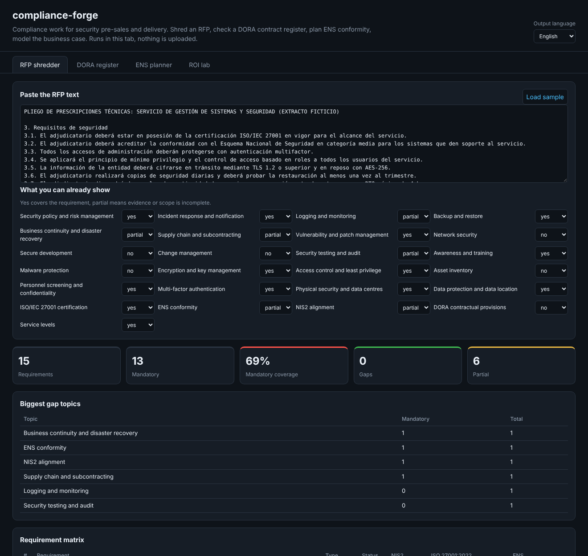

# compliance-forge

[](https://github.com/jvch0512/compliance-forge/actions/workflows/ci.yml)

The paperwork around a security deal, turned into tools. Paste an RFP and get every security requirement mapped to NIS2, ISO 27001:2022 and ENS with your coverage and gaps. Feed a DORA contract register and see which contracts miss which Article 30 clause. Work out which ENS category a system is in and what to do first. Put a euro range and a payback on a security investment. Gate a pipeline on NIS2 readiness. English and Spanish, zero runtime dependencies, nothing uploaded.



## Run

```bash
npm install
npm test                       # 25 tests
npm start                      # UI on http://127.0.0.1:8787, localhost only

node dist/src/cli.js rfp  examples/rfp-es.txt --have examples/capabilities.json --lang es
node dist/src/cli.js dora examples/contracts.csv --today 2026-11-13
node dist/src/cli.js ens  examples/ens-profile.json
node dist/src/cli.js roi  examples/roi-model.json
node dist/src/cli.js nis2 examples/nis2-fail.json --max-none 0
```

Every command takes `--lang en|es` and `--json`. Exit codes: `dora` exits 1 on high findings, `nis2` exits 1 when the gate fails, `rfp --fail-on-mandatory-gap` exits 1 on any mandatory requirement not fully covered, 2 on bad input. Real outputs are in `docs/` and CI fails if they drift.

## What each part does

**RFP shredder** ([sample](docs/sample-rfp.md)). Splits the text into sentences, keeps those that state an obligation (must, shall, deberá, se valorará and similar, accent-safe) and match one of 25 security topics, and marks them mandatory or desirable. Each topic maps to a NIS2 Article 21(2) measure, ISO/IEC 27001:2022 Annex A controls and ENS control families. You say what you can show (yes, partial) and each requirement becomes covered, partial or gap, with mandatory coverage as the headline and the biggest gap topics ranked.

**DORA register check** ([sample](docs/sample-dora.md)). Reads a CSV of ICT third-party contracts. Validates the LEI including its ISO 7064 check digits, flags expired and soon-to-expire contracts, checks the Article 30(2) clauses on every contract and the extra Article 30(3) clauses (subcontracting, contingency plans, TLPT participation, audit rights, exit strategy) on critical or important ones, and shows provider concentration. This is a readiness check of Articles 28 to 30, not the official register of information reporting template.

**ENS planner** ([sample](docs/sample-ens.es.md)). The category of a system is the highest level of its five dimensions (Royal Decree 311/2022, Annex I). Basic category gets self-assessment and a declaration of conformity, medium and high need certification and an audit at least every two years. Control families are ranked into a work order by maturity, weight and effort. Control numbers inside a family change between editions, so the tool stays at family level and points to the CCN-STIC guides.

**ROI lab** ([sample](docs/sample-roi.md)). Scenarios with a rate and a three-point loss, controls with a reduction per scenario. Controls act independently (the prevented share is 1 minus the product of what each leaves). Reports expected annual loss before and after, ROSI, payback, and a seeded simulation of the horizon with the P10, median, P90 net and the probability of a positive net. When the expected value is positive but the median run is not, it says so: rare large losses drive the number, so present it as insurance.

**NIS2 gate and GitHub Action.** Reuses the scoping engine from [discovery-copilot](https://github.com/jvch0512/discovery-copilot) (vendored in `src/nis2/`). Fails the job when an essential or important entity has more Article 21(2) measures with no implementation than you allow. Writes a summary to the job page.

```yaml
- uses: jvch0512/compliance-forge@main
  with:
    profile: compliance/nis2-profile.json
    max-none: "0"
    lang: en
```

The action builds the tool inside the job and runs it there. Nothing is sent anywhere. This repo's CI runs the action against a passing and a failing profile.

## Safety notes

- Strict CSP (`default-src 'none'`, scripts and styles from `self`, no inline code). Pasted text reaches the page only through `textContent`.
- Markdown output escapes pipes and newlines in table cells.
- The dev server binds to 127.0.0.1 and serves only `public/`, `dist/src` and `examples/`.
- Examples are fictional companies, with LEIs generated to pass the check digits.

## Limits

Topic detection is keyword based: it will miss a requirement phrased in an unusual way and occasionally over-match, so read every row before you answer a tender. The ISO and ENS mappings are a working map, not a certification statement. The ROI result is only as good as your loss estimates. **This is pre-sales and delivery support, not legal advice: confirm duties with counsel and the competent authority.**

MIT licensed.
